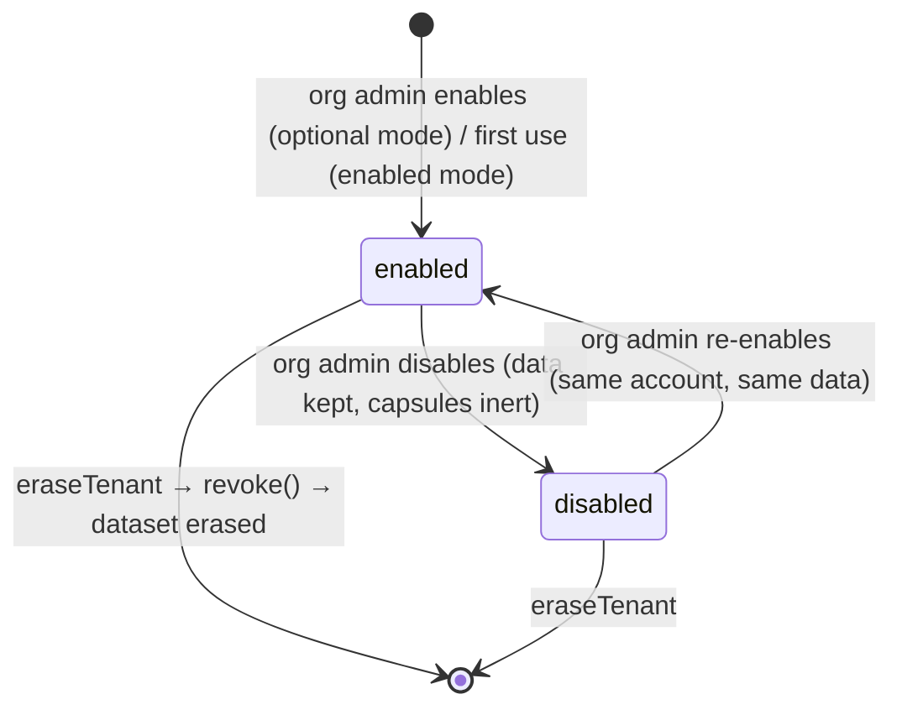
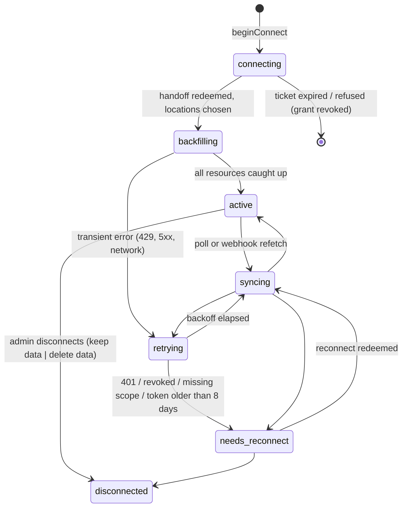
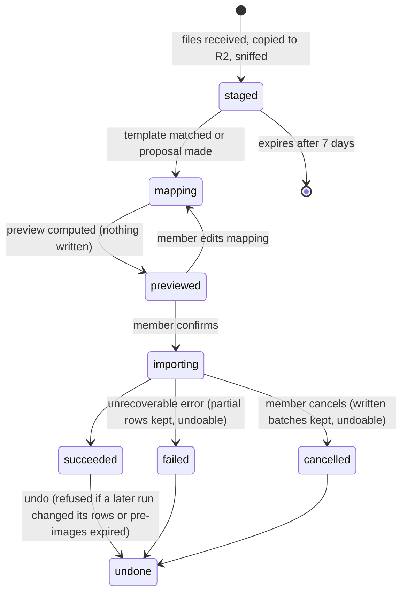

# Data Model: Retail Data Layer

The design behind FR-012–FR-015. Consumers (the agent, dashboards, reports) see only the **public
views** in §2. The **storage tables** behind them in §3 use a compact encoding (research R3), and the
guarded SQL interface refuses them (research R4). The kernel record that makes a dataset exist is in
§6.

## 1. Where each piece lives

| Holder | One per | Holds |
|---|---|---|
| Directory DO (`UserDirectoryDurableObject`, kernel) | tenant | `tenantAccounts` record: the dataset's `Fetcher<GatekeeperUser>` and its enabled state (§6) |
| `RetailDataset` DO (SQLite) | dataset (= tenant) | canonical storage tables, views, rollups, sources, runs, templates, staged imports, pre-images, settings |
| `RetailConnection` DO | provider connection | OAuth credentials, granted scopes, per-resource checkpoints, status and backoff, webhook dedupe |
| `RetailWebhookRoute` DO | provider external account (`square:<merchantId>`) | the set of connections that receive that account's events |
| `RetailGatekeeper` DO (overseer facet) | binding | observer state only |
| R2 `RETAIL_RAW` | — | raw records: `ds/<datasetId>/src/<sourceId>/run/<runId>/<seq>` |

DO names are prefixed with the deployment's `sharingDomain`: `<domain>\0dataset\0<datasetId>`,
`<domain>\0conn\0<connectionId>` and `<domain>\0route\0<provider>\0<externalAccountId>`.
`datasetId` is random and is minted by `createAccount()`. A tenant id never appears in a name.

## 2. Public views: the canonical schema consumers read

Conventions (all views):

- **Keys**:
  - `id` is an integer that is opaque and stable. It survives re-sync, re-import and rebuild.
  - Foreign keys are `<table>_id`.
  - `source_id` references `sources`. `source_kind` is `square` | `stripe` | `toast` | `csv`.
  - `source_record_id` is the provider's or file's id.
  - `(source_id, source_record_id)` is unique, and that uniqueness is what makes ingestion
    idempotent (FR-005).
  - CSV rows that have no id get `source_record_id = 'fp:' + sha256(mapped key fields)`, and the
    import report warns about them (US2.5).
- **Lineage (FR-013)**: `run_id` (the run that last wrote the row), `mapping_version`, `ingested_at`
  (first written) and `updated_at`.
- **Money (FR-014)**:
  - `*_amount` columns are integer minor units, beside `currency` (ISO 4217, upper case).
  - Zero-decimal currencies use exponent 0.
  - Nothing in this model adds amounts across currencies.
- **Time**:
  - `*_at` columns are ISO 8601 UTC text, `2026-11-17T14:03:00Z`.
  - `business_date` is `YYYY-MM-DD`: the local trading day after the location's `day_cutoff`.
  - `local_hour` is 0–23 in the location's zone.
- **Quantities**: `quantity` is a real number with exactly 4 decimals of precision. It is stored as an integer in ten-thousandths, so the sums are exact.
- **Deletes**: `deleted_at` is non-null when the provider deleted or merged the record (soft delete). Views include soft-deleted rows, so history keeps its references, and metrics ignore them.
- **PII**: the columns marked **PII** show masked values unless the dataset's `pii_unmasked` setting is on (research R12).

### `locations`
A store, restaurant or online channel.

| column | type | notes |
|---|---|---|
| name | text | |
| kind | text | `store` \| `restaurant` \| `online` \| `other` |
| timezone | text | IANA zone, validated with `Intl.DateTimeFormat` |
| day_cutoff | text | `HH:MM`; `04:00` default for restaurants, `00:00` otherwise |
| currency | text | default currency |
| address_city, address_region, address_country, address_postal_code | text, nullable | |

### `customers`
| column | type | notes |
|---|---|---|
| first_name, last_name | text, nullable | **PII**; masked → `J.` / `S.` |
| email | text, nullable | **PII**; masked → `j***@example.com` |
| phone | text, nullable | **PII**; masked → `***-***-1234` |
| email_hash, phone_hash | text, nullable | HMAC-SHA-256 with a per-dataset key, over lowercase email and E.164 phone; usable in joins |
| created_at | text | first seen at the source |
| marketing_opt_in | boolean, nullable | |
| canonical_customer_id | integer, nullable | set when a cross-source match is confirmed (`match_links`, §4, §7) |

### `products`
One row per sellable variant. `parent_product_id` groups variants, e.g. "Latte" → "Latte, large".

| column | type | notes |
|---|---|---|
| name, variant_name | text | |
| parent_product_id | integer, nullable | |
| sku, barcode | text, nullable | SKU is the cross-source match key |
| category | text, nullable | the source's category or menu group |
| price_amount, currency | integer, text, nullable | current list price |
| unit_cost_amount | integer, nullable | from the provider or a CSV product import |
| is_active | boolean | |
| canonical_product_id | integer, nullable | set when a match is confirmed (`match_links`, §4, §7) |

### `orders`
A sale, or a check for restaurants.

| column | type | notes |
|---|---|---|
| location_id | integer | |
| customer_id | integer, nullable | |
| order_number | text, nullable | the number staff and receipts show |
| status | text | `open` \| `completed` \| `voided` \| `refunded` \| `partially_refunded` |
| channel | text | `in_store` \| `online` \| `delivery` \| `other` |
| opened_at, closed_at | text, nullable | |
| business_date | text | |
| local_hour | integer | from `closed_at`, else `opened_at` |
| currency | text | |
| gross_amount | integer | Σ line `gross_amount` (non-voided lines) |
| discount_amount | integer | order-level plus line-level discounts |
| service_charge_amount | integer | |
| tax_amount | integer | |
| tip_amount | integer | |
| total_amount | integer | what the customer was charged |
| prices_include_tax | boolean | |
| guest_count | integer, nullable | restaurants |

### `line_items`
| column | type | notes |
|---|---|---|
| order_id, location_id | integer | `location_id` is copied from the order |
| business_date | text | copied from the order |
| product_id | integer, nullable | null for custom or open-price items |
| name | text | as sold, even if the product is renamed later |
| quantity | real (4 dp) | can be fractional (sold by weight) |
| unit_price_amount | integer | includes modifier prices |
| gross_amount | integer | quantity × unit price |
| discount_amount, tax_amount | integer | |
| net_amount | integer | `gross_amount − discount_amount` |
| modifiers | json | `[{ "name", "price_amount", "quantity" }]` |
| unit_cost_amount | integer, nullable | cost at the time of sale, if known |
| is_voided | boolean | an item voided on an order that otherwise stands (Toast `Void?`) |
| currency | text | |

### `transactions`
Money movements: payments and refunds, and, from Stripe, payouts and fees.

| column | type | notes |
|---|---|---|
| order_id | integer, nullable | null for payouts and unattached payments |
| location_id | integer, nullable | |
| parent_transaction_id | integer, nullable | refund → the payment it reverses |
| kind | text | `payment` \| `refund` \| `payout` \| `fee` \| `adjustment` |
| tender | text, nullable | `card` \| `cash` \| `gift_card` \| `wallet` \| `other` |
| card_brand | text, nullable | never card numbers or last-4 |
| amount | integer | positive; `kind` gives the direction |
| sales_amount, tax_amount, tip_amount | integer, nullable | refund breakdown when the source gives one; otherwise `sales_amount = amount − tip_amount` and `tax_amount` is null (`breakdown_known = false`) |
| breakdown_known | boolean | |
| fee_amount | integer, nullable | processor fee, where known |
| currency | text | |
| occurred_at | text | |
| business_date | text | in the location's zone; the UTC date when there is no location |
| status | text | `succeeded` \| `failed` \| `pending` |

### `refund_items`
Line-level returns. They make `units_sold` and product-level net sales exact. Rows exist only where
the source itemizes a refund: Square order returns, Shopify refunded line items, Toast voided items
on a paid check.

| column | type | notes |
|---|---|---|
| transaction_id | integer, nullable | the refund transaction, if known |
| order_id, line_item_id, location_id | integer | |
| product_id | integer, nullable | |
| quantity | real (4 dp) | positive |
| sales_amount, tax_amount | integer | |
| business_date | text | the refund's trading day |
| currency | text | |

### `inventory`
Current stock per product, location and source. There is one row each, replaced on sync.

| column | type | notes |
|---|---|---|
| product_id, location_id | integer | |
| quantity_on_hand | real (4 dp), nullable | |
| state | text | `in_stock` \| `low` \| `out_of_stock` (only a state is known, e.g. a Toast stock export) |
| as_of | text | when the source last reported it |

### `inventory_movements`
Present where the source gives changes (Square).

| column | type | notes |
|---|---|---|
| product_id, location_id | integer | |
| quantity_delta | real (4 dp) | signed |
| reason | text | `sale` \| `receive` \| `adjustment` \| `transfer` \| `waste` \| `other` |
| occurred_at | text | |

### `sources` (public, read-only)
`id`, `kind`, `label`, `status`, `last_success_at`, `coverage_from`, `coverage_to`. This lets
consumers name a source in results. Credentials and provider account ids are never in this view.

### Rollups (public views over rollup tables, kept current by every run)

| view | key | measures |
|---|---|---|
| `daily_sales` | business_date, location_id, channel, currency | orders, voided_orders, gross_amount, discount_amount, refund_amount, net_amount, tax_amount, tip_amount, service_charge_amount, units, refunded_units, cost_amount, lines_missing_cost |
| `daily_product_sales` | business_date, location_id, product_id, channel, currency | units, refunded_units, gross_amount, discount_amount, refund_amount, net_amount, cost_amount, units_missing_cost |
| `customer_summary` | customer_id, currency | first_order_date, last_order_date, orders, lifetime_net_amount |
| `daily_source_coverage` | business_date, location_id, source_id | orders, transactions |

The definitions of the metrics computed from these views are in `contracts/metrics.md`.

## 3. Storage encoding (internal; refused by guarded SQL)

- Each view `X` reads a storage table `store_X`. Ids are `INTEGER PRIMARY KEY`, timestamps are
  `INTEGER` epoch seconds, `quantity_e4` is an `INTEGER`, booleans are `INTEGER` 0/1, and the
  tables are `STRICT`.
- Views convert values with `strftime('%Y-%m-%dT%H:%M:%SZ', x, 'unixepoch')` and
  `quantity_e4 / 10000.0`.
- Every storage table also carries `rebuild_gen INTEGER` (research R16).

Indexes:

- unique `(source_id, source_record_id)` on every canonical table;
- `(business_date, location_id)` on `store_orders`, `store_line_items`, `store_transactions` and
  `store_refund_items`;
- `(order_id)` on `store_line_items`, `store_transactions` and `store_refund_items`;
- `(customer_id)` on `store_orders`;
- `(email_hash)` and `(phone_hash)` on `store_customers`;
- `(sku)` on `store_products`.

**Scale target** (SC-006a: 10 locations × 3 years ≈ 3M orders, 15M line items, 4.5M transactions):
about 5.5 GB with the indexes. That is 55% of the 10 GB object cap, against the ≤ 75% that SC-006a
allows. Rollups add under 50 MB. The estimate is checked by the load test (research R3).

## 4. Operational entities (internal tables in `RetailDataset`)

| table | fields | rules |
|---|---|---|
| `sources` | id, kind, label, status, connection_name (`RetailConnection` DO name, connectors only), external_account_label, default_timezone, default_currency, created_by (member id), created_at, last_success_at, last_error_code, last_error_message | One per connection or named CSV source. A CSV source groups the imports of one exporting system, so overlapping exports share a key space. |
| `runs` | id, source_id, kind (`backfill` \| `sync` \| `import` \| `rebuild` \| `undo`), status, template_version_id, mapping_version, started_by, started_at, finished_at, counts (json: per table `{fetched, written, updated, skipped, rejected}`), progress (json: `{phase, done, total, etaSeconds}`), undo_of, cursor (json: resumable position) | Counts and progress are updated per batch. |
| `run_rejections` | run_id, table, raw_object_id, row_index, reason_code, column, detail | At most 10,000 per run. `detail` never holds a value from a PII column. |
| `raw_objects` | id, run_id, r2_key, kind (`csv_file` \| `provider_page`), file_role (e.g. `toast.OrderDetails`), bytes, sha256, record_count | Bytes count against `RETAIL_RAW_QUOTA_BYTES`. |
| `templates` | id, name, source_id, origin (`builtin` \| `user`), builtin_key (`toast` \| `square_item_detail` \| `shopify_orders`), current_version_id, created_by | |
| `template_versions` | id, template_id, version, mapping (json: mapping document, `contracts/mapping-document.md`), header_signatures (json), created_by, created_at | Immutable once a run has used it. |
| `staged_imports` | id, source_id, files (json: `[{raw_object_id, name, sniff:{encoding, delimiter, header_row, footer_rows}, headers, role}]`), status, deterministic_mapping (json), agent_mapping (json, nullable), chosen_template_version_id, run_id, created_by, expires_at | Abandoned staged imports expire after 7 days, and their raw objects are deleted with them. |
| `row_versions` | run_id, table, row_id, seq, before (json, null for an insert), expires_at | Import runs only. Kept for `RETAIL_UNDO_RETENTION_DAYS` (30). |
| `dirty_days` | location_id, business_date | The rollup recompute queue (research R17). |
| `settings` | pii_unmasked (+ changed_by, changed_at), backfill_years (1–3, default 3), size_warned_at, email_hmac_key | `email_hmac_key` is generated once and never leaves the DO. |
| `match_links` | id, kind (`customer` \| `product`), row_id (the source-specific customer or product row), canonical_id, basis (`email` \| `sku` \| `name`), status, decided_by, decided_at | Story 6. `email` and `sku` proposals are pre-ticked; `name` proposals never link without a person (§7). |

## 5. Validation rules

| Rule | Applies to | On failure |
|---|---|---|
| Currency is ISO 4217 (exponent table); input is normalized to upper case | every money row | row rejected (`unknown_currency`) |
| Amounts parse to integers in minor units after the template's locale rules (symbol, thousands separator, decimal mark, sign or parentheses) | CSV | row rejected (`bad_amount`) |
| Dates parse with the template's format. Times without a zone use the location's zone. | CSV | row rejected (`bad_date`) |
| `timezone` is a zone `Intl` accepts | locations | reject the location, which rejects its orders |
| An order needs `source_record_id` or fingerprint fields, a business date, a currency and a location | orders | row rejected (`missing_required`) |
| `line_items.order_id` resolves within the same run or already exists | line items | row rejected (`orphan_line`) |
| `total_amount` matches `gross − discount + service + tax(if exclusive) + tip` to within 1 minor unit per line | orders | accepted with warning `total_mismatch`, shown in the preview and the report |
| A Toast set has `OrderDetails`, `ItemSelectionDetails` and `PaymentDetails` | Toast import | import refused before preview, naming the missing file (US2.8) |
| Quantity has at most 4 decimals | line items, refund items, inventory | rounded half-even with warning `quantity_rounded` |
| A row with a PII column has its hash and mask computed at ingest | customers | — |

Business rules:

- A refund is a `transactions` row with `kind = refund`, plus optional `refund_items`. It is never a
  negative order.
- A void sets `orders.status = voided`. The row is kept and excluded from sales metrics.
- Split tenders are one order with several `payment` transactions.
- `business_date` is derived from `closed_at`, else `opened_at`, in the location's zone with the
  `day_cutoff` applied. Toast uses the export set's date instead (research R11).

## 6. Kernel record: tenant-held account

`UserDirectoryDurableObject` gains a typed-storage KV collection `tenantAccounts`, keyed by `vendorId`:

| field | type | notes |
|---|---|---|
| vendorId | string | lowercase |
| account | `Fetcher<GatekeeperUser>` | from `createAccount()` (persistent stub) |
| description | `AccountDescription` | cached from `account.describe()` |
| enabled | boolean | |
| enabledBy | string | profile id of the organization administrator, or `"operator"` in `enabled` mode |
| enabledAt, disabledAt | number, nullable | |

## 7. State transitions

**Tenant account** (kernel):

The deployment mode `disabled` overrides both states: no capsule is installed and
`#assertResourceEnabled` refuses.

**Provider connection** (`sources.status`):

**CSV import** (`staged_imports.status` → `runs.status`):

**Match link** (Story 6): `proposed → confirmed | rejected`, and `confirmed → undone`. Only a
confirmation sets `canonical_*_id`, and an undo clears it.
