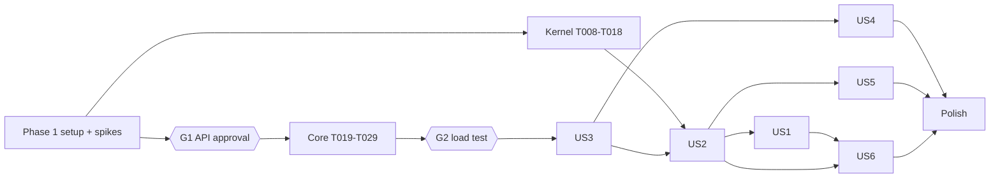

# Tasks: Retail Data Layer

**Input**: `specs/006-retail-data-layer/` (plan.md, spec.md, research.md, data-model.md, contracts/, quickstart.md)

**Tests**: Included. Constitution VI requires refusal tests for every security boundary, and the spec's independent tests define the behaviour each story must show.

**Gates**:

- **G1 (operator API approval)**: the `write-gatekeeper` skill, Step 3, requires approval of `contracts/retail-binding.md`. All tasks in `packages/gatekeeper-retail/src` from Phase 2 on wait for it.
- **G2 (load-test result)**: if headroom is under 25%, the split by location goes in before Phase 4.

## Format: `[ID] [P?] [Story] Description`

## Phase 1: Setup and spikes

- [X] T001 Scaffold `packages/gatekeeper-retail` (package.json `@gadgets/gatekeeper-retail`, tsconfig*.json, vite.config.ts and vite.app.config.ts and build-app.ts copied from `packages/gatekeeper-context`, vitest.config.ts for workerd with capnwebValidate, vitest.node.config.ts) in packages/gatekeeper-retail/
- [X] T002 Write `packages/gatekeeper-retail/cloudflare.config.ts` with the shared factory from scripts/worker-config.ts: `RETAIL_RAW` r2 binding, `limits.cpu_ms: 300000`, flags `allow_irrevocable_stub_storage` and `nodejs_als`, migration `v1` new_sqlite_classes [RetailDataset, RetailConnection, RetailWebhookRoute, RetailGatekeeper]; then run `pnpm configs:generate` (v1 now names all four; RetailConnection and RetailWebhookRoute joined with T053/T054)
- [X] T003 Add dependencies `csv-parse`, `@guanmingchiu/sqlparser-ts`, `fflate` and `zod` (catalog) to packages/gatekeeper-retail/package.json, and run `pnpm install`
- [X] T004 [P] Spike: load sqlparser-rs WASM inside workerd and parse the R4 test cases in packages/gatekeeper-retail/__tests__/spike-sqlparser.test.ts. On failure, switch to the node-sql-parser fallback (research R4) and record the result in research.md
- [ ] T005 [P] Spike: confirm that a pipelined `filesApi.downloadFile(id)` passed into a frame `ui` method streams backend→gatekeeper without passing through the browser, in packages/workshop-backend/__integration__/stream-relay.spike.test.ts. Record the result in research.md R8 and delete the spike afterwards
- [ ] T006 [P] Confirm that the deploy service provisions gatekeeper R2 buckets, and record it in research.md R10 (fallback: `RetailRawArchive` DO behind `RawStore`)
- [X] T007 Release wiring in scripts/release/manifest-lib.ts: retail goes in SINGLETON and NO_DEFAULT_CRED_INPUTS, and gets `sharingDomain = $PUBLIC_BASE_URL`. Also set sharingDomain in scripts/run-dev-server.ts and scripts/preview/staging-config.ts. Regenerate scripts/release/testdata/golden-manifest.json with `UPDATE_GOLDEN=1`

## Phase 2: Foundational (blocks all stories)

### Kernel PR: tenant-held accounts (contracts/kernel-seam.md)

- [X] T008 Add `VendorDescription.tenantScoped`, `TenantAppContext`, `TenantAccess`, `AppUiContext.tenant` and `TenantFileDelivery`, each with a doc comment, in packages/workshop-shared/src/gatekeeper.ts
- [X] T009 Add `TenantAmbientCreationSpec` to the creation-spec union, plus `TenantGatekeeperInfo`, `TenantGatekeepersApi` and `AuthenticatedApi.getTenantGatekeepersApi`, all doc-commented, in packages/workshop-shared/src/api.ts
- [X] T010 Add the `tenantAccounts` typed-storage KV collection to the directory schema in packages/workshop-backend/src/storage-schema/
- [X] T011 Implement `enableTenantAccount` (deduplicated `createAccount()`), `disableTenantAccount`, `listTenantAccounts`, `getTenantSingletonClass`, `startTenantAppUi` and `getTenantVerifier` in packages/workshop-backend/src/user-directory.ts, refusing the `""` directory. Make `eraseTenant` revoke tenant accounts first and throw on failure
- [X] T012 Create `TenantGatekeepersApiImpl` and `TenantAccessImpl` (`@validateRpc()`, per-call `current()` re-read, refuse a changed tenant; personal tenant or `isOrganizationAdmin` may manage) in packages/workshop-backend/src/tenant-gatekeepers.ts
- [X] T013 Mint `getTenantGatekeepersApi()` (null without Clerk). Merge tenant apps into `listGatekeeperApps`/`getGatekeeperApp`, passing `tenant: { memberId, memberName, access }`, in packages/workshop-backend/src/server.ts
- [X] T014 Add `getTenantSingletonGatekeeperClass(vendorId)`, which goes through `#assertResourceEnabled`. Skip `tenantScoped` vendors in `listProvidedAccounts` and `#provisionMissingAccounts`, in packages/workshop-backend/src/user.ts
- [X] T015 Handle `tenantAmbient` in packages/workshop-backend/src/overseer.ts:
  - reconcile it in `ensureAmbientCapsules`;
  - check per turn that it is still enabled in `prepareChatBindings`;
  - in the observer flow, take the verifier from `getTenantVerifier` only when `sameTenant`;
  - leave it out of blueprint export.
- [X] T016 Make `user.deleted` also erase directory `u_<id>` in packages/workshop-backend/src/auth/clerk-webhook.ts
- [X] T017 Add a test fixture tenant-scoped vendor in packages/integration-tests (or the `fixtures/gatekeeper-test` vendor) for the kernel tests
- [X] T018 Write invariant tests 1–8 from contracts/kernel-seam.md in packages/workshop-backend/__integration__/tenant-gatekeepers.test.ts:
  - a non-admin enabling is refused;
  - a demoted admin is refused on the next call;
  - B never sees A's capsule;
  - a member leaving keeps the record;
  - `organization.deleted` revokes;
  - `user.deleted` erases the personal directory;
  - the operator's disabled mode blocks;
  - deployments without Clerk get null.

### Gatekeeper core (after G1)

- [X] T019 Create the dataset storage schema in packages/gatekeeper-retail/src/dataset/schema.ts: STRICT `store_*` tables, public views, rollup tables, internal tables and indexes, per data-model.md §2–§4, with schema versioning inside the DO
- [X] T020 Create the `RetailDataset` DO skeleton in packages/gatekeeper-retail/src/dataset/dataset-do.ts: schema init, `databaseSize` reporting, a 70% warning, and erase (`deleteAll` plus R2 prefix deletion in alarm batches)
- [X] T021 [P] Implement the `RawStore` interface and its R2 implementation (keys `ds/<datasetId>/src/<sourceId>/run/<runId>/<seq>`, quota accounting) in packages/gatekeeper-retail/src/dataset/raw-store.ts
- [X] T022 Implement ingest in packages/gatekeeper-retail/src/dataset/ingest.ts:
  - upsert by `(source_id, source_record_id)` inside `transactionSync` batches;
  - lineage columns;
  - pre-images for import runs;
  - dirty days;
  - business date and local hour computed with `Intl`.
- [X] T023 [P] Implement hashing and masking (per-dataset HMAC key, masks, `customers` view recreation) in packages/gatekeeper-retail/src/dataset/masking.ts
- [X] T024 Implement the vendor (`autoProvisionsAccount`, `tenantScoped`, `createAccount` minting a random `datasetId`), `RetailAccount` (singleton, `providesUi`, `revoke` → erase) and `RetailVerifier.hasDatasetAccess` in packages/gatekeeper-retail/src/vendor.ts
- [X] T025 Implement the `RetailGatekeeper` facet (startSession, getTypeScriptTypes, getAgentCatalog, observer strategy B via kit `aclObservers`) in packages/gatekeeper-retail/src/gatekeeper.ts; export the entrypoints and a 404 fetch in packages/gatekeeper-retail/src/index.ts
- [X] T026 Copy contracts/retail-binding.md into packages/gatekeeper-retail/src/types.d.ts, and create the symlink src/types.txt -> types.d.ts
- [X] T027 [P] Create the module logger and observability context (`gatekeeper.retail`, `vendorId: "retail"`) in packages/gatekeeper-retail/src/observability.ts
- [X] T028 Run the SC-006a load test with synthetic data generated through ingest (10 locations × 3 years), reporting size and query times, in packages/gatekeeper-retail/__tests__/load/load.test.ts (run on demand). **Gate G2.** (passed at scale 0.1: ~4.2 GB projected, 42% of the cap; research R3)
- [X] T029 [P] Ingest tests: idempotency, lineage, business-date cutoff and DST, quantity scale, money parsing, in packages/gatekeeper-retail/__tests__/ingest.test.ts

## Phase 3: User Story 3 — Query the canonical data (P1)

Built first among the stories because every other story reads through it.

**Goal**: the `RETAIL_DATA` binding with `describe`, guarded `run`, `metric`, masking and observations.
**Independent test**: load the same sales through two sources into two datasets; the standard metrics are identical; every mutating or forbidden query is refused and nothing changes.

- [X] T030 [P] [US3] Guard refusal tests (every case in quickstart.md "Guarded SQL", plus checks that row counts and the schema are unchanged) in packages/gatekeeper-retail/__tests__/sql-guard.test.ts
- [X] T031 [P] [US3] Metric tests (refund, void, split tender, tax-inclusive, zero-decimal currency, multi-currency, partial margin) in packages/gatekeeper-retail/__tests__/metrics.test.ts
- [X] T032 [US3] Implement the four-layer SQL guard (parse, allow-list, `EXPLAIN QUERY PLAN` check, `transactionSync` change and schema guard, row and byte caps, typed columns) in packages/gatekeeper-retail/src/dataset/sql-guard.ts
- [X] T033 [US3] Implement the rollup day recompute (`daily_sales`, `daily_product_sales`, `daily_source_coverage`, `customer_summary`) in packages/gatekeeper-retail/src/dataset/rollups.ts
- [X] T034 [US3] Implement the metric SQL and groupBy rules from contracts/metrics.md in packages/gatekeeper-retail/src/dataset/metrics.ts
- [X] T035 [US3] Implement the `RetailData` session (`describe`, `run`, `metric`, with `authorizeObservation` after the read and before the return, and logging without values) in packages/gatekeeper-retail/src/session.ts
- [X] T036 [P] [US3] Isolation and observer tests (three datasets; cross-tenant `addObserver` refused) in packages/gatekeeper-retail/__tests__/isolation.test.ts

## Phase 4: User Story 2 — Upload a POS CSV export (P1)

**Goal**: pick files from Files, sniff, map (template, deterministic proposal or agent suggestion), preview, import in the background, report, undo, and save templates; plus Toast sets.
**Independent test**: a one-row-per-line-item CSV produces the right orders and line items with matching totals, and re-uploading it changes nothing.

- [X] T037 [P] [US2] Tests for sniffing and decoding (encoding, delimiter, header row, footer, quoted newline) in packages/gatekeeper-retail/__tests__/sniff.test.ts
- [X] T038 [P] [US2] Tests for templates (Toast set with a missing file, repeated check, Shopify fill-down, Square Item Detail) in packages/gatekeeper-retail/__tests__/templates.test.ts
- [X] T039 [P] [US2] Tests for import and undo (report counts, cancellation, undo refused after a later overlapping run, fingerprint warning) in packages/gatekeeper-retail/__tests__/import.test.ts
- [X] T040 [P] [US2] Implement decoding and sniffing in packages/gatekeeper-retail/src/import/decode.ts and packages/gatekeeper-retail/src/import/sniff.ts
- [X] T041 [P] [US2] Implement the streaming CSV reader (csv-parse with `info.bytes` resume offsets) in packages/gatekeeper-retail/src/import/csv-stream.ts
- [X] T042 [US2] Implement the mapping document (zod schema, validation, interpreter with joins and fill-down) in packages/gatekeeper-retail/src/import/mapping.ts (the interpreter is in src/import/interpret.ts)
- [X] T043 [P] [US2] Implement the built-in templates in packages/gatekeeper-retail/src/import/templates/toast.ts, square-item-detail.ts and shopify-orders.ts
- [X] T044 [US2] Implement the deterministic proposer (header-signature template match, alias dictionary) in packages/gatekeeper-retail/src/import/propose.ts
- [X] T045 [US2] Implement the alarm-driven import loop (R2 range reads, batches, cursor, cancel, report, rejections) in packages/gatekeeper-retail/src/import/import-loop.ts (staging, runs, undo and templates in src/import/data-area.ts)
- [X] T046 [US2] Add `pendingImports` and `proposeImportMapping` (`submitAction`, auto-approvable, apply/reject, simulation) to packages/gatekeeper-retail/src/session.ts and packages/gatekeeper-retail/src/gatekeeper.ts
- [X] T047 [US2] Implement the `RetailAppApi` import, template and undo methods, with a per-call `access.current()` check, in packages/gatekeeper-retail/src/app-api.ts
- [X] T048 [US2] Load the frontend-conventions skill. Then build the Data app shell and imports UI (file pick via host, mapping editor, preview, progress, report, "Ask the agent" via `openPrompt`) in packages/gatekeeper-retail/app/
- [X] T049 [US2] Add the host method `pickTenantFiles` and the `TenantFilePicker` dialog in packages/workshop-frontend/src/SandboxedGatekeeperApp.tsx and packages/workshop-frontend/src/files/TenantFilePicker.tsx, with tests
- [X] T050 [US2] Add the "Enable for organization" control for tenant-scoped vendors on the Connectors page in packages/workshop-frontend/src/

## Phase 5: User Story 1 — Connect Square / Stripe (P1)

**Goal**: an administrator connects a provider through the handoff; backfill with progress; sync by webhook and poll; failure states; disconnect.
**Independent test**: a Square sandbox's orders, items, payments and customers are correct, and a new order appears within the interval.

- [X] T051 [P] [US1] Tests: phished handoff refused, forged or unsigned webhook rejected, 401 → needs_reconnect, backoff on 429, disconnect with delete removes only that source; in packages/gatekeeper-retail/__tests__/connectors.test.ts
- [X] T052 [US1] Implement the scheduler-style planner (watchdog, batch, capped backoff, teardown) in packages/gatekeeper-retail/src/connectors/planner.ts
- [X] T053 [US1] Implement the `RetailConnection` DO (CredentialCoordinator, staged credentials, ticket and nonce flow, checkpoints, status) in packages/gatekeeper-retail/src/connectors/connection-do.ts
- [X] T054 [P] [US1] Implement the `RetailWebhookRoute` DO in packages/gatekeeper-retail/src/connectors/webhook-route-do.ts
- [X] T055 [US1] Implement the Square client and mapping (scopes, refresh every 7 days or sooner, newest-first backfill, updated_at cursor, daily 3-day re-read, refetch on webhook) in packages/gatekeeper-retail/src/connectors/square.ts and packages/gatekeeper-retail/src/connectors/square-map.ts
- [X] T056 [US1] Implement the HTTP routes (OAuth callbacks, signed webhooks) per contracts/http-routes.md in packages/gatekeeper-retail/src/index.ts
- [X] T057 [US1] Add the connection methods to `RetailAppApi` (beginConnect, redeemConnectHandoff, locations, syncNow, reconnect, disconnect) in packages/gatekeeper-retail/src/app-api.ts, and the sources UI in packages/gatekeeper-retail/app/sources/
- [X] T058 [US1] Add the host method `openConnectPopup` and the `kind: "app"` redemption in packages/workshop-frontend/src/SandboxedGatekeeperApp.tsx and packages/workshop-frontend/src/ConnectHandoffPage.tsx, with tests
- [X] T059 [US1] Add `deploy-inputs.json` (SQUARE_*), remove retail from NO_DEFAULT_CRED_INPUTS, and regenerate the golden manifest, in packages/gatekeeper-retail/deploy-inputs.json and scripts/release/
- [X] T060 [US1] Implement the Stripe App OAuth, backfill, webhooks plus `/v1/events` backstop and mapping in packages/gatekeeper-retail/src/connectors/stripe.ts and stripe-map.ts; add the STRIPE_* deploy inputs (blocked on Stripe Marketplace review for release)

## Phase 6: User Story 4 — Provenance and completeness (P2)

**Independent test**: a CSV with a missing day and invalid rows shows the gap and the rejections, and lineage traces each row back to its file and row.

- [X] T061 [P] [US4] Coverage and gap tests in packages/gatekeeper-retail/__tests__/coverage.test.ts
- [X] T062 [US4] Implement `coverage` (including gap detection) and `lineage` in the session and in the app API: packages/gatekeeper-retail/src/session.ts and packages/gatekeeper-retail/src/app-api.ts (shared logic in src/dataset/coverage.ts)
- [X] T063 [US4] Build the coverage, rejections and lineage UI in packages/gatekeeper-retail/app/coverage/

## Phase 7: User Story 5 — Fix a mapping and re-run it (P2)

**Independent test**: a wrong mapping is corrected and re-applied; the rows change and there are no duplicates.

- [X] T064 [P] [US5] Rebuild tests in packages/gatekeeper-retail/__tests__/rebuild.test.ts
- [X] T065 [US5] Implement rebuild runs (`rebuild_gen`, deleting rows the rebuild no longer produces, built-in version bumps) in packages/gatekeeper-retail/src/dataset/ingest.ts, and `reapplyTemplate` in packages/gatekeeper-retail/src/app-api.ts, plus its UI in packages/gatekeeper-retail/app/templates/

## Phase 8: User Story 6 — Cross-source matching (P3)

- [X] T066 [P] [US6] Matching tests (email and SKU proposed; name never auto-linked; undo) in packages/gatekeeper-retail/__tests__/matching.test.ts
- [X] T067 [US6] Implement `match_links` proposals, confirm/reject/undo and canonical id propagation in packages/gatekeeper-retail/src/dataset/matching.ts, with the admin UI in packages/gatekeeper-retail/app/settings/

## Phase 9: Polish

- [X] T068 [P] Settings UI (PII unmasking, backfill depth, erase dataset) in packages/gatekeeper-retail/app/settings/ (the backfill depth stays beside the connect buttons on the Sources tab, from T057)
- [X] T069 [P] Write docs/retail-data.md (operator setup, Square/Stripe apps, limits, design), and add a packages/gatekeeper-retail entry to AGENTS.md
- [X] T070 Run `pnpm configs:check`, `pnpm lint`, `pnpm test`, and the manual scenarios in quickstart.md (the manual scenarios need a deployed instance with live Square/Stripe apps and were not run here)

## Dependencies

## Parallel examples

- Phase 1: T004, T005 and T006 together.
- The kernel tasks T008–T018 run alongside the gatekeeper core once G1 is passed.
- US3: T030, T031 and T036 (tests) together; then T032 and T033.
- US2: T037–T041 and T043 together.

## Implementation strategy

The MVP is Phase 1, Phase 2, US3 and US2: CSV import into a queryable dataset that spec 007 can
build on. US1 (Square, then Stripe) follows. US4–US6 come after that, one increment each.
