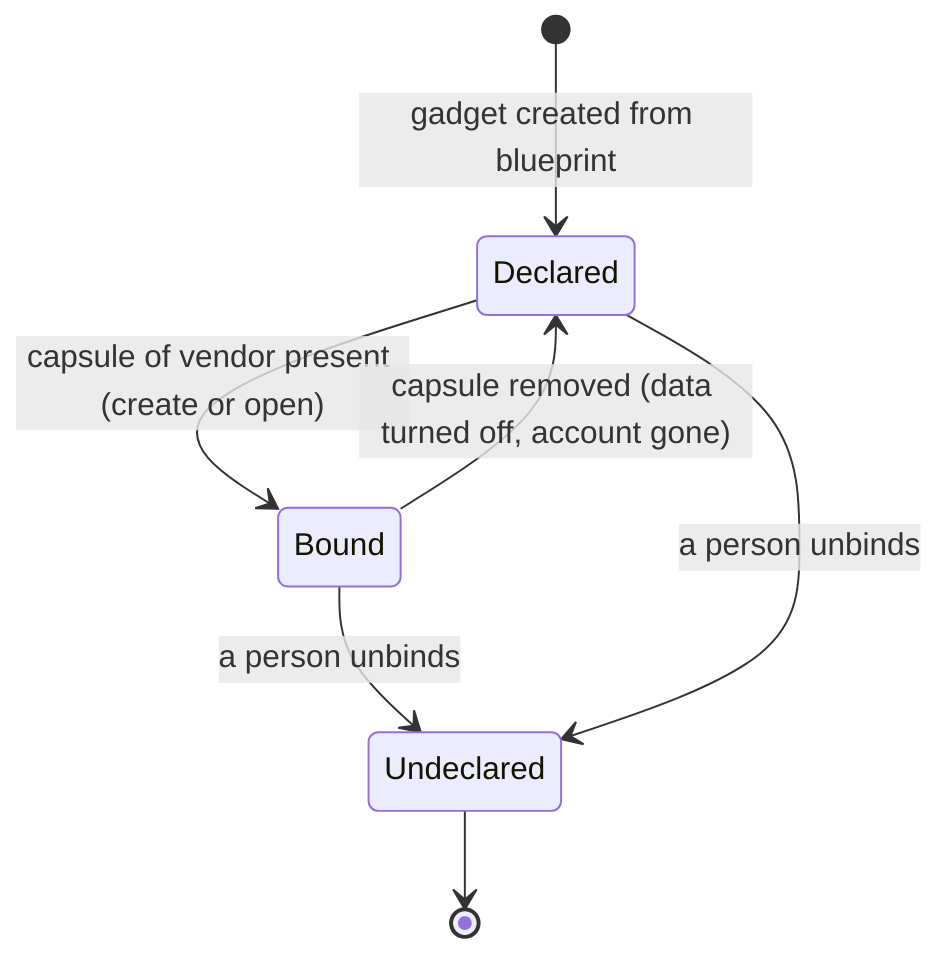

# Data Model: Data-Focused Output Formats

Three places hold state. Field-level shapes are in the contracts; this file is the map, the rules
and the lifecycles.

## 1. Kernel records

| Entity | Where | Change |
|---|---|---|
| `BlueprintBinding` | `BlueprintMetadata.bindings` (blueprint KV record) | new variant `{ type: "ambient", vendorId }` |
| `GadgetRecord` | overseer storage | new optional `ambientBindings: Record<bindingName, vendorId>` |
| `BindingRecord` (edge) | `GadgetRecord.bindings` | unchanged; an ambient declaration becomes an ordinary edge to the capsule |
| `FormatCuration` | `AdminConfig.formats` | unchanged shape; `agentHint` seeded from the manifest on first promotion; entries withdrawn when their bundled blueprint is dropped |
| `promotedFormatBlueprints` | `AdminSettings` storage | ids the installer promoted; shrinks when a bundled id is dropped |
| `BundledBlueprintManifest` | `blueprint.json` | new optional `agentHint` |

Rules:

- `ambientBindings[name]` is set only from a blueprint's declaration, removed by a person's unbind
  and renamed with the edge. It never names an account, dataset or capsule id.
- An edge made from a declaration is indistinguishable from any other edge; it is deleted with its
  capsule and re-created by the reconcile when a capsule of the vendor exists again.

## 2. Dashboard gadget storage

| Entity | Key | Lifetime |
|---|---|---|
| Dashboard meta (title, freshness, default filters, tile order, revision) | `meta` | created with starter content on first read |
| Tile (title, visual, saved query, filters used, layout, version) | `t:<id>` | until removed; at most 40 |
| Cached results per tile (default filters first, then up to 8 others) | `r:<tileId>` | replaced on run; dropped when the tile's query changes; all purged when data is off |
| Data status (ok/empty/off/error, date range, complete-through, locations) | `status` | refreshed when older than the freshness setting |
| Undo history (structure snapshots) | `undo` | 50 past, 50 future |

Not stored: a viewer's filter selection (it lives in the viewer's page).

Validation: tile title 1–120 characters; layout inside a 12-column grid, `w` 2–12, `h` 2–12, no
overlaps after `setLayout`; saved query and visual per the `data` library's validators; a tile's
`uses` is a subset of the filters its query can react to.

## 3. Report gadget storage

| Entity | Key | Lifetime |
|---|---|---|
| Report meta (title, period, locations, letterhead, section order, edition summaries, revision) | `meta` | created with starter content on first read |
| Section (heading, text or data) | `s:<id>` | until removed; at most 60 |
| Edition (as-of, period, copy of every section, each data block's outcome, fingerprints) | `e:<id>` | immutable; at most 24; oldest unpinned pruned |
| Data status | `status` | as the Dashboard's |
| Undo history (structure and text, never editions) | `undo` | 50 past, 50 future |
| Handled schedule runs | `runs` | last 50 `runId`s |

```mermaid
stateDiagram-v2
  [*] --> Draft: created (starter sections, no edition)
  Draft --> Generated: generate
  Generated --> Generated: generate (new edition; earlier ones kept)
  Generated --> Generated: edit text (clears that section's review flag)
  Generated --> Withheld: data turned off
  Withheld --> Generated: data turned on again
```

Edition rules:

- Written once. Its blocks are copies, so later edits to sections, title or letterhead change
  nothing in it (FR-025).
- A generation never fails as a whole because one block failed; the block stores its failure.
- `review` and `stale` are derived on read from sections, the latest edition and the edition named
  by each text section's `reviewedEdition`; they are not stored.

## 4. Shared value types (the `data` library)

`SavedQuery` (metric or SQL with named parameters), `VisualSpec`, `FilterValues`,
`ResolvedFilters`, `QueryResult` / `QueryFailure`, `DataStatus`. See
`contracts/data-library.md`.

Derived, never stored: the anchor date (the earlier of today and the dataset's last business
date) and the resolved period of a preset.

## 5. What crosses which boundary

| From → to | Carries | Never carries |
|---|---|---|
| Viewer's page → gadget server | filter values, tile ids, structure edits | query text for execution outside a saved or previewed query |
| Gadget server → `RETAIL_DATA` | read-only SQL with bound parameters, metric requests | viewer-supplied text spliced into SQL |
| Gadget storage → another organization | nothing (a workspace is opened only by its tenant) | results, editions |
| Gadget → blueprint | code and starter content | tiles a person built, results, editions, letterhead |
| Blueprint → new gadget | the `RETAIL_DATA` declaration | any dataset, account or capsule id |
