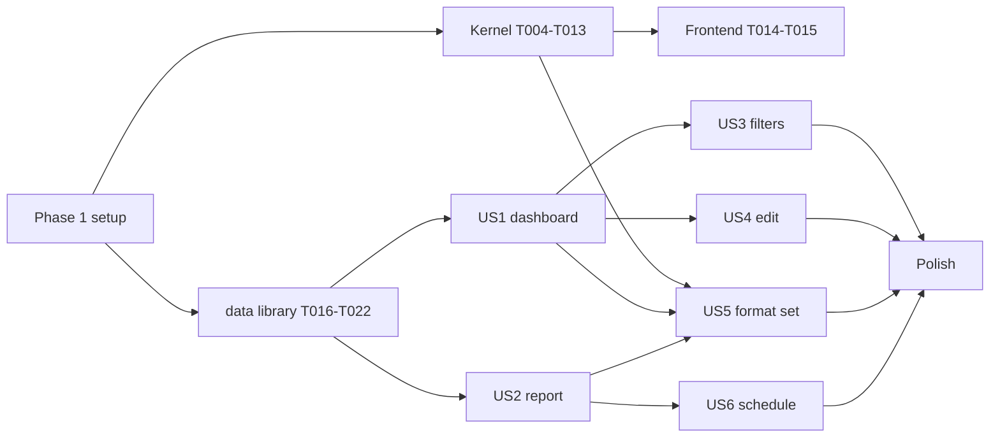

---

description: "Task list for spec 007: Dashboards, Reports and Sheets"
---

# Tasks: Data-Focused Output Formats (Dashboards, Reports and Sheets)

**Input**: Design documents from `/specs/007-data-output-formats/`

**Prerequisites**: plan.md, spec.md, research.md, data-model.md, contracts/, quickstart.md

**Tests**: Included. Constitution VI requires refusal tests for every security boundary, and each story's independent test in `spec.md` defines the behaviour it must show.

**Organization**: Tasks are grouped by user story. Abbreviations: `BB` = `packages/bundled-blueprints`, `WB` = `packages/workshop-backend`, `WS` = `packages/workshop-shared`, `WF` = `packages/workshop-frontend`.

## Format: `[ID] [P?] [Story] Description`

- **[P]**: Can run in parallel (different files, no dependencies)
- **[Story]**: Which user story the task belongs to
- Each description names the files it changes

## Phase 1: Setup

**Purpose**: Small shared pieces every later phase builds on

- [X] T001 Create branch `007-data-output-formats` and confirm `.specify/feature.json` points at `specs/007-data-output-formats`
- [X] T002 [P] Export a `restore` symbol from the `cloudflare:workers` test stub in BB/__tests__/stubs/cloudflare-workers.ts, so a gadget defining `[restore]()` can be imported under vitest
- [X] T003 [P] Accept an optional `agentHint` (1–400 characters) in `blueprint.json` and carry it on `BundledBlueprint`: BB/src/manifest.ts, BB/src/generate.ts, with cases in BB/__tests__/files.test.ts (or the manifest's own test file) for accepted, too long and wrong type

---

## Phase 2: Foundational (Blocking Prerequisites)

**Purpose**: The kernel seam and the shared library. No story works without them.

**⚠️ CRITICAL**: The kernel tasks (T004–T013) are one commit group, reviewable apart from everything else (constitution I). Contract: `contracts/kernel-seam.md`.

### Kernel: ambient blueprint bindings

- [X] T004 Add the `{ type: "ambient"; vendorId: string }` variant to `BlueprintBinding`, doc-commented, and update the docs of `OutputFormatOffer.requiresSetup` and `newWorkspaceFromBlueprint` in WS/src/api.ts
- [X] T005 Add `GadgetRecord.ambientBindings?: Record<string, string>`, doc-commented, in WB/src/storage-schema/overseer-storage.ts
- [X] T006 Implement `bindAmbientDeclarations(gadgetId?)` and call it from `ensureAmbientCapsules()`, `createGadget()` (new `blueprint.ambientBindings` parameter) and `initializeFromBlueprint()`; make `unbindWorkpiece` drop and `renameBinding` move the declaration, in WB/src/overseer.ts
- [X] T007 Make `fetchBlueprint()` return `ambientBindings` and leave filled ambient bindings out of its notes and `missingBindings`; handle the variant in `describeBindingKind` and `#missingBlueprintBindings`; export an edge to an ambient capsule as the ambient variant in `collectBindingMetadata`, in WB/src/overseer.ts
- [X] T008 Handle the variant in `formatMissingBlueprintBindings`, pass `blueprint.ambientBindings` through the `createGadget` tool, and reword the "a doc, a deck, a tracker" example, in WB/src/agent.ts (and the `AgentHooks` type it declares)
- [X] T009 [P] Compute `requiresSetup` from non-ambient bindings only in WB/src/admin-config.ts
- [X] T010 [P] Refuse an assignment that names an ambient binding in `newWorkspaceFromBlueprint`, WB/src/server.ts
- [X] T011 Retire dropped bundled formats after promotion and seed `agentHint` on first promotion; replace the "converse isn't handled" comment, in WB/src/admin-settings.ts
- [X] T012 [P] Unit tests for invariants 5, 6, 9 and 10 of `contracts/kernel-seam.md`: WB/__tests__/admin-config.test.ts, WB/__tests__/admin-settings-audit.test.ts (or a new WB/__tests__/bundled-format-retirement.test.ts), and the blueprint tests that cover `newWorkspaceFromBlueprint`
- [X] T013 Integration tests for invariants 1–4, 7 and 8 of `contracts/kernel-seam.md` with the tenant-scoped fixture vendor that spec 006 added: WB/__integration__/ambient-blueprint-bindings.test.ts

### Frontend: ambient bindings are shown, never picked

- [X] T014 [P] Load the `frontend-conventions` skill, then list an ambient binding read-only as "Connected automatically", keep it out of the assignments and never let it block Create, in WF/src/BlueprintLandingPage.tsx with cases in WF/src/BlueprintLandingPage.test.tsx
- [X] T015 [P] Give ambient bindings no "needs" badge in WF/src/components/BlueprintCard.tsx (and its test, if one exists)

### The `data` gadget library

Contract: `contracts/data-library.md`.

- [X] T016 [P] Types and validators: BB/libraries/data/src/retail.ts and BB/libraries/data/src/model.ts
- [X] T017 [P] Named-parameter compiler and `usesFilter`: BB/libraries/data/src/params.ts with BB/libraries/data/__tests__/params.test.ts (hostile values, strings and comments, refusals)
- [X] T018 [P] Periods: BB/libraries/data/src/period.ts with BB/libraries/data/__tests__/period.test.ts
- [X] T019 Running, status, label resolution and caps: BB/libraries/data/src/run.ts with BB/libraries/data/__tests__/run.test.ts (depends on T016–T018)
- [X] T020 [P] Formatting: BB/libraries/data/src/format.ts with BB/libraries/data/__tests__/format.test.ts
- [X] T021 Charts, table, Markdown-lite and styles: BB/libraries/data/src/chart.ts, table.ts, styles.ts with BB/libraries/data/__tests__/chart.test.ts (depends on T016, T020)
- [X] T022 Entries and docs: BB/libraries/data/server.ts, BB/libraries/data/client.ts, BB/libraries/data/README.md, and the drift test BB/libraries/data/__tests__/retail-types.test.ts

**Checkpoint**: `pnpm exec vp run -F @gadgets/bundled-blueprints build` and the library's tests pass; the kernel tests pass. Stories can start.

---

## Phase 3: User Story 1 - Ask for a dashboard over my retail data (Priority: P1) 🎯 MVP

**Goal**: New → Dashboard, or the agent, produces a dashboard whose tiles show the organization's numbers with no connection step.

**Independent Test**: With a fake reader holding known totals, the starter dashboard's KPI tiles show those totals, each tile names its query, a failing tile does not break the others, and the off and empty states show their messages.

Contract: `contracts/dashboard-gadget.md`.

### Tests for User Story 1

- [X] T023 [P] [US1] Server tests for starter content, tile add/update/remove with validation, `runTiles` caching, per-tile failure, refusal of write queries, and the off, snapshot and connection-gone modes: BB/blueprints/workspace-dashboard/__tests__/server.test.ts
- [X] T024 [P] [US1] Layout tests (clamp, collision push-down, first free slot): BB/blueprints/workspace-dashboard/__tests__/layout.test.ts
- [X] T025 [P] [US1] Client tests (jsdom): cached results render before any run; off and empty states; a failed tile shows the error and the hand-off text; charts carry `role="img"` and a summary; tile details list query, period, last run, rows and duration: BB/blueprints/workspace-dashboard/__tests__/client.test.ts

### Implementation for User Story 1

- [X] T026 [P] [US1] Manifest with the `RETAIL_DATA` ambient binding and `agentHint`: BB/blueprints/workspace-dashboard/blueprint.json
- [X] T027 [P] [US1] Shared types: BB/blueprints/workspace-dashboard/files/lib/protocol.ts
- [X] T028 [P] [US1] Starter tiles: BB/blueprints/workspace-dashboard/files/lib/starter.ts
- [X] T029 [P] [US1] Grid placement: BB/blueprints/workspace-dashboard/files/lib/layout.ts
- [X] T030 [US1] `Gadget`: storage, data access modes, `subscribe`/`open`, `describeData`, `getDashboard`, `addTile`/`updateTile`/`removeTile`, `setTitle`, `previewQuery`, `runTiles` for the default filters with the result cache, and `ExportHandler` (PDF, CSV): BB/blueprints/workspace-dashboard/files/server.ts
- [X] T031 [US1] UI: header, grid, tiles drawn from cached results then refreshed, notes, details disclosure, show-as-table, failed-tile hand-off, off/empty/snapshot states, live `changed`/`results`, print and export layout: BB/blueprints/workspace-dashboard/files/client.ts
- [X] T032 [US1] Agent-facing README (how to reach the gadget, `describeData` first, tile API table, query rules, standard figures use metrics, examples): BB/blueprints/workspace-dashboard/files/README.md

**Checkpoint**: The dashboard builds into the bundle and its tests pass.

---

## Phase 4: User Story 2 - Produce a report as of a date (Priority: P1)

**Goal**: A report whose editions are frozen as of their generation, regenerable, with earlier editions readable, exportable to PDF.

**Independent Test**: Generate, change the fake reader's data and the sections, read the edition back unchanged; regenerate and read both.

Contract: `contracts/report-gadget.md`.

### Tests for User Story 2

- [X] T033 [P] [US2] Edition logic tests (fingerprints, review rule, stale detection, retention): BB/blueprints/workspace-report/__tests__/editions.test.ts
- [X] T034 [P] [US2] Server tests for starter content, section CRUD and move, edition immutability, a second edition, per-block failure, off mode withholding without deleting, snapshot mode, letterhead validation, hostile period values: BB/blueprints/workspace-report/__tests__/server.test.ts
- [X] T035 [P] [US2] Client tests (jsdom): latest view; earlier edition with banner; review flag and Mark as reviewed; no-edition, off and empty states; incomplete-period note; export mode prints letterhead and as-of line with no controls: BB/blueprints/workspace-report/__tests__/client.test.ts

### Implementation for User Story 2

- [X] T036 [P] [US2] Manifest with the `RETAIL_DATA` ambient binding and `agentHint`: BB/blueprints/workspace-report/blueprint.json
- [X] T037 [P] [US2] Shared types: BB/blueprints/workspace-report/files/lib/protocol.ts
- [X] T038 [P] [US2] Starter sections: BB/blueprints/workspace-report/files/lib/starter.ts
- [X] T039 [P] [US2] Editions (build, fingerprint, review, stale, retention): BB/blueprints/workspace-report/files/lib/editions.ts
- [X] T040 [US2] `Gadget`: storage, data access modes, `subscribe`/`open`/`getEdition`, `describeData`, `getReport`, `readEdition`, section CRUD and move, `setTitle`/`setPeriod`/`setLetterhead`, `markReviewed`, `generate`, `pinEdition`/`deleteEdition`, `previewQuery`, undo/redo, and `ExportHandler` (PDF, Markdown): BB/blueprints/workspace-report/files/server.ts
- [X] T041 [US2] UI: header with edition picker and Regenerate, page with letterhead and as-of line, sections and data blocks, earlier-edition banner, review flags, stale notes, incomplete-period note, in-place text editing, section add/move/delete, period and letterhead controls, live `changed`/`generated`, print and export layout: BB/blueprints/workspace-report/files/client.ts
- [X] T042 [US2] Agent-facing README (read `readEdition` before writing narrative, section API table, generate, letterhead, scheduling recipe): BB/blueprints/workspace-report/files/README.md

**Checkpoint**: The report builds into the bundle and its tests pass.

---

## Phase 5: User Story 3 - Explore a dashboard with filters and refresh (Priority: P1)

**Goal**: A viewer's date range and location choices re-run only the tiles that use them; refresh on demand; results carry their age.

**Independent Test**: With two tiles that use the date range and one that does not, changing the range calls the reader for exactly the two, with the new dates as parameters.

- [X] T043 [P] [US3] Server tests: a filter change re-runs only tiles whose `uses` includes it; fresh cached outcomes are not re-run unless `force`; non-default filter results are cached per tile up to the cap and never broadcast; filter values with quotes and SQL reach the reader only as parameters: add to BB/blueprints/workspace-dashboard/__tests__/server.test.ts
- [X] T044 [P] [US3] Client tests: changing a filter calls `runTiles` with only the tiles that use it; a running tile keeps its picture with `aria-busy`; "Updated" shows the age; a second page's filters do not move this one's: add to BB/blueprints/workspace-dashboard/__tests__/client.test.ts
- [X] T045 [US3] `runTiles` with arbitrary filters, per-tile `uses`, the non-default result cache, `setDefaultFilters`, `setFreshness`: BB/blueprints/workspace-dashboard/files/server.ts
- [X] T046 [US3] Filter bar (presets, custom range, location multi-select), Refresh, age display, background refresh of stale tiles on open: BB/blueprints/workspace-dashboard/files/client.ts

**Checkpoint**: Stories 1–3 work together.

---

## Phase 6: User Story 5 - The deployment offers Dashboards, Reports and Sheets (Priority: P1)

**Goal**: Exactly three formats ship; Docs and Slides are gone from the code, the menu and the agent's guidance; existing documents and decks keep working.

**Independent Test**: The generated bundle holds exactly the three ids; an install run on a store that had Docs and Slides promoted withdraws both and keeps their records.

- [X] T047 [US5] Delete BB/blueprints/workspace-docs, BB/blueprints/workspace-slides and BB/libraries/pptx (sources, tests, fixtures); remove `commonmark` and `@types/commonmark` from BB/package.json and refresh pnpm-lock.yaml with `pnpm install`
- [X] T048 [US5] Re-key backend tests that named the removed formats: WB/__tests__/bundled-blueprints.test.ts (the expected format map becomes dashboard, report, spreadsheet with their export formats), WB/__tests__/blueprints.test.ts, WB/__tests__/cli-admins-only.test.ts, WB/__tests__/admin-config.test.ts, WB/__tests__/message-format-refs.test.ts
- [X] T049 [P] [US5] Re-key integration tests from Docs to Sheets: packages/integration-tests/__tests__/workshop-admin-audit.test.ts, workshop-admin-policy.test.ts, workshop-blueprints.test.ts, workshop-sharing.test.ts
- [X] T050 [P] [US5] Re-key frontend and CLI fixtures: WF/src/features/blueprint-updates/blueprintReference.ts and its test, the frontend `messageFormatRefs` test, packages/api-cli/src/run.test.ts
- [X] T051 [P] [US5] Rewrite the Docs-dependent turn of packages/workshop-evals/evals/change-calendar.eval.ts for a Report (`output.id === "document"` stays; content is read with `getReport()` / `readEdition()`)
- [X] T052 [P] [US5] Replace the Docs and Slides home suggestions with a dashboard and a report suggestion in WF/src/components/AppShell/HomeTaskSuggestions.tsx, and the example copy in WF/src/components/format/AdminFormatsPanel.tsx, with their tests
- [X] T053 [US5] Add an `agentHint` for Sheets ("Use for tables a person fills in by hand. Not for charts or summaries of the organization's data: use a Dashboard or a Report.") in BB/blueprints/workspace-sheets/blueprint.json
- [X] T054 [US5] Backend test that the bundle is exactly `format.dashboard`, `format.report`, `format.spreadsheet`, that each `client.js` has `@media print`, each `server.js` exports `ExportHandler`, and that each of the two new manifests declares `RETAIL_DATA` as ambient: WB/__tests__/bundled-blueprints.test.ts

**Checkpoint**: `pnpm --filter @gadgets/workshop-backend test:run` passes with the new bundle.

---

## Phase 7: User Story 4 - Edit tiles directly or through the agent (Priority: P2)

**Goal**: Move, resize, retype, rename and delete tiles directly, with shared undo; query changes through the agent show before and after.

**Independent Test**: Move and resize a tile, switch its visual type, undo twice; `updateTile` with a new query returns the tile before and after.

- [X] T055 [P] [US4] Server tests: `setLayout` clamps and resolves overlaps; undo and redo restore structure and are shared; `updateTile` returns before and after and drops that tile's cache only when the query or `uses` changed; changing the visual type alone runs nothing: add to BB/blueprints/workspace-dashboard/__tests__/server.test.ts
- [X] T056 [P] [US4] Client tests: arrow keys move and Shift+arrow keys resize the focused tile and focus stays on it; the visual-type select lists only compatible types and re-renders without a run; snapshot mode offers no edit controls: add to BB/blueprints/workspace-dashboard/__tests__/client.test.ts
- [X] T057 [US4] `setLayout`, `undo`, `redo` and the undo history: BB/blueprints/workspace-dashboard/files/server.ts
- [X] T058 [US4] Edit mode: drag and resize snapping to the grid, keyboard move and resize, visual-type select, rename, delete, Undo/Redo, read-only query with "ask the agent": BB/blueprints/workspace-dashboard/files/client.ts

---

## Phase 8: User Story 6 - Regenerate a report on a schedule (Priority: P3)

**Goal**: The agent registers a schedule for a report with the existing Scheduled Tasks binding; a person enables it; each firing produces one edition.

**Independent Test**: The restored hook generates one edition per `runId`, and with `monthly: "first"` only in the first week of the month.

- [X] T059 [P] [US6] Server tests: the hook is idempotent on `runId`; `monthly: "first"` skips days 8–31 in the firing's time zone; an unknown restore type throws; a firing while data is off produces no edition and does not throw: add to BB/blueprints/workspace-report/__tests__/server.test.ts
- [X] T060 [US6] `[restore]()` and the `ScheduledTaskHook` with the `runs` record: BB/blueprints/workspace-report/files/server.ts
- [X] T061 [US6] Scheduling recipe for the agent (weekly rule plus `monthly: "first"`, ask for the time zone, the member enables the hook): BB/blueprints/workspace-report/files/README.md

---

## Phase 9: Polish & Cross-Cutting Concerns

- [X] T062 [P] Reword docs for the new set: docs/blueprints.md (examples, the note that a dropped bundled format is withdrawn, the ambient binding kind), README.md (formats and "What to try"), BB/README.md, BB/libraries/README.md, BB/libraries/sync/README.md, BB/libraries/ui/README.md
- [X] T063 [P] Add `packages/bundled-blueprints` data-format notes to AGENTS.md (the `data` library, the ambient binding rule, where the contracts are)
- [X] T064 Run `pnpm exec vp run -F @gadgets/bundled-blueprints build` and `pnpm --filter @gadgets/bundled-blueprints test:run`; fix what they find
- [X] T065 Run `pnpm --filter @gadgets/workshop-backend test:run`, `pnpm --filter @gadgets/workshop-frontend test:run`, `pnpm --filter @gadgets/integration-tests test:run` and `pnpm --filter @gadgets/api-cli test:run`; fix what they find
- [X] T066 Run `pnpm lint` (script types, config checks, workspace build) and `UPDATE_GOLDEN=1 node --test scripts/release/manifest-lib.test.ts`, confirming the golden manifest is unchanged
- [X] T067 Smoke run: `pnpm dev-server`, create an account, `pnpm cf-os api` to instantiate `format.dashboard` and `format.report` into workspaces and call `open()` / `getDashboard()` / `getReport()` on each, confirming the off state (no Clerk locally) and the starter content
- [X] T068 Record in `quickstart.md` which manual scenarios were run and which still need a Clerk-enabled instance with retail data

---

## Dependencies & Execution Order

### Phase Dependencies



- The kernel seam (T004–T013) and the `data` library (T016–T022) are independent of each other.
- US1 and US2 depend only on the library; they do not depend on the kernel seam to build and pass their own tests (the binding is declared in the manifest, and the gadgets tolerate its absence).
- US5's deletion (T047) can start as soon as the kernel seam is in; its bundle test (T054) needs US1 and US2.
- T048 depends on T047 and on both new blueprints existing.

### Within Each Story

- Tests are written with the implementation and must fail without it.
- `lib/` modules before `server.ts`; `server.ts` before `client.ts`; README last.
- Tasks in different stories that touch the same file (the dashboard's `server.ts` and `client.ts` across US1, US3 and US4; the report's across US2 and US6) run in story order.

### Parallel Opportunities

- T002, T003 together.
- T009, T010, T012 beside the overseer work; T014, T015 once T004 is in.
- T016, T017, T018, T020 together; then T019, T021; then T022.
- US1 and US2 in parallel once the library is in.
- T049, T050, T051, T052 together.

---

## Parallel Example: after the library lands

```text
Task: "Dashboard blueprint: T023-T032, then T043-T046, T055-T058"   (one owner for its server.ts and client.ts)
Task: "Report blueprint: T033-T042, then T059-T061"                 (one owner for its server.ts and client.ts)
Task: "Format set: T047, T049-T053"
```

---

## Implementation Strategy

### MVP

Phases 1–2, then US1 (Phase 3) and US5's deletion and curation (Phase 6): a deployment that offers a Dashboard connected to its retail data with no wiring.

### Incremental Delivery

1. Kernel seam and library → reviewable alone, no visible change.
2. US1 → a working dashboard from the menu and from the agent.
3. US2 → reports with editions and PDF.
4. US3 → filters and refresh.
5. US5 → the format set changes and Docs/Slides are withdrawn on upgrade.
6. US4, US6 → direct editing and schedules.

---

## Notes

- Kernel changes follow `contracts/kernel-seam.md` exactly; anything beyond it needs the plan's constitution check revisited.
- A blueprint's `files/` are outside the repo's lint; the `data` library is inside it.
- No new npm dependency may be added to `packages/bundled-blueprints`.
- Commit by group: kernel + shared; frontend; library; each blueprint; removal and re-keyed tests; docs.
