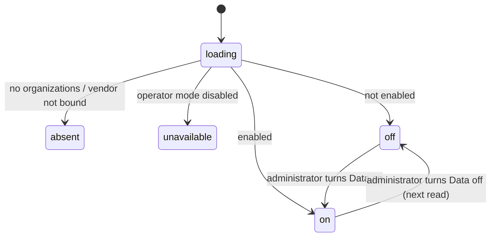

# Data Model: Data Page

No new stored entity. The feature adds two indexes and several derived shapes.

## Stored

| What | Where | Change |
| --- | --- | --- |
| `store_<t>_run`, `store_<t>_source` indexes | each dataset's SQLite (`gatekeeper-retail`) | new migration for orders, line_items, transactions, products, customers, locations, inventory |
| Staged imports, runs, mappings, templates, canonical rows | dataset | unchanged |
| Tenant account record (Data on/off) | tenant directory (kernel) | unchanged; written through the existing `TenantGatekeepersApi.enable()` |

## Derived

- **Data area state** (Workshop, `contracts/workshop-data-page.md`): `loading | absent | unavailable | off(mayManage) | on`, from `TenantGatekeepersApi.list()`.

- **Data home state** (Data app): `empty` (no orders, no staged imports) or `with data`.
- **Basic mapping**: a view over the import's `MappingDocument`: row level (order or item), one
  column per basic field, and the settings. It never stores anything of its own; the full editor
  edits the same document.
- **Browse catalog / page / row detail** (`contracts/data-app-api.md`): computed per request from
  the public views; nothing cached.

## Rules

- A browse query names only a table from the fixed list; every value it carries is a bound
  parameter.
- Rows "from an import" are rows whose `run_id` is that import's run (the run that last wrote them).
- Customer personal columns come from the `customers` view, masked unless the administrator allowed
  them.
- Page size is 100; offsets are multiples of 100 up to 1,000,000; search text is 1–100 characters.
