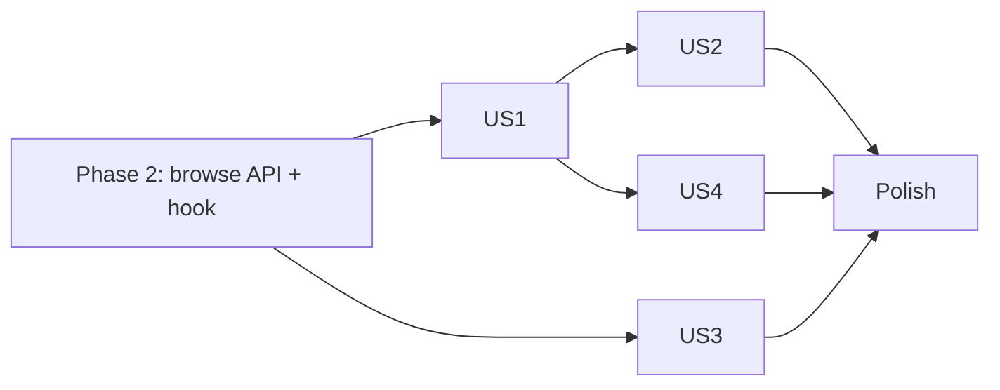

---

description: "Task list for spec 008: the Data page"
---

# Tasks: Data Page (Upload, Map and Browse Retail Data)

**Input**: Design documents from `/specs/008-data-page/`

**Prerequisites**: plan.md, spec.md, research.md, data-model.md, contracts/, quickstart.md

**Tests**: Included (constitution VI: refusal tests for the browse boundary and for turning Data on).

`WF` = `packages/workshop-frontend`, `GR` = `packages/gatekeeper-retail`, `BB` = `packages/bundled-blueprints`.

## Format: `[ID] [P?] [Story] Description`

## Phase 1: Setup

- [X] T001 Create branch `008-data-page` and point `.specify/feature.json` at `specs/008-data-page`

---

## Phase 2: Foundational (Blocking Prerequisites)

**Purpose**: the browse capability and the Data state hook, which Home, Browse and the Workshop page all read.

- [X] T002 Add the index migration (run_id and source_id on the seven browsable tables) to `SCHEMA_MIGRATIONS` in GR/src/dataset/schema.ts
- [X] T003 Add `BrowseTable`, `BrowseColumn`, `BrowseTableInfo`, `BrowseCatalog`, `BrowseQuery`, `BrowsePage`, `RowDetail` and the three `RetailAppClient` methods to GR/src/app-api-types.ts (contracts/data-app-api.md)
- [X] T004 Implement the fixed table definitions, validation, catalog, page, large-table narrowing and row detail in GR/src/dataset/browse.ts, and expose `browseCatalog`, `browseRows`, `rowDetail` on `RetailDataset` in GR/src/dataset/dataset-do.ts
- [X] T005 Implement `getBrowseCatalog`, `browseRows`, `getRowDetail` on `RetailAppApi` with the per-call member check in GR/src/app-ui.ts
- [X] T006 [P] Browse tests (paging, filters, undo, hostile values, refusals, masking, narrowing, detail, counts) in GR/__tests__/browse.test.ts
- [X] T007 [P] Implement `useDataArea()` and `DATA_VENDOR_ID` in WF/src/features/data/dataArea.ts with WF/src/features/data/dataArea.test.ts

**Checkpoint**: the retail workerd suite and the hook's tests pass.

---

## Phase 3: User Story 1 - Find Data and get started (Priority: P1) 🎯 MVP

**Goal**: Data is always in the navigation; the page shows the organization's state and lets an administrator turn it on in place.

**Independent Test**: with a scripted `TenantGatekeepersApi`, each state renders; Turn on Data calls `enable` once and the page becomes the app host; a member sees no button.

- [X] T008 [US1] Load the `frontend-conventions` skill; implement `DataPage` in WF/src/features/data/DataPage.tsx with WF/src/features/data/DataPage.test.tsx
- [X] T009 [US1] Add the route WF/src/routes/data.$.tsx (document title "Data") rendering `DataPage` with the splat as the app path
- [X] T010 [US1] Redirect `/gatekeepers/retail/*` to `/data/*` in WF/src/routes/gatekeepers_.$appId.$.tsx
- [X] T011 [US1] Add the Data item to WF/src/components/AppShell/Sidebar.tsx and both lists in WF/src/components/Header.tsx, skipping `DATA_VENDOR_ID` in the dynamic app lists; cover "listed once / absent" in the nearest nav test
- [X] T012 [US1] After a toggle, refresh the Data state in WF/src/features/tenant-gatekeepers/TenantGatekeepersSection.tsx
- [X] T013 [US1] Replace Overview with Home in GR/app/App.tsx (tabs Home, Browse, Imports, Templates, Coverage, Sources, Settings) with app-level `openImport`, `openRun` and `browse` navigation, and an optional `request` prop on GR/app/imports/ImportsPage.tsx
- [X] T014 [US1] Implement Home (empty and with-data states, recent runs with View rows, staged imports with Continue, the former overview content below) in GR/app/home/HomePage.tsx, moving `OverviewPage`'s content into it and deleting GR/app/overview/
- [X] T015 [P] [US1] Home tests in GR/app/home/HomePage.test.tsx and the tab list in GR/app/App.test.tsx

---

## Phase 4: User Story 2 - Upload a CSV and map it the basic way (Priority: P1)

**Goal**: one-step upload from Home and a basic mapping panel in front of the full editor.

**Independent Test**: a file with common POS headers reaches an enabled Preview without opening More options; a missing required field blocks Preview and is named.

- [X] T016 [US2] Implement the default-target upload in GR/app/home/uploadCsv.ts and wire **Upload a CSV** on Home to it
- [X] T017 [P] [US2] Implement the pure helpers in GR/app/imports/basicFields.ts with GR/app/imports/basicFields.test.ts
- [X] T018 [US2] Implement GR/app/imports/BasicMapping.tsx and show it first in GR/app/imports/ImportView.tsx, with **More options** revealing the parsing settings, samples and full `MappingEditor` over the same state, and the re-upload notice
- [X] T019 [P] [US2] BasicMapping component tests in GR/app/imports/BasicMapping.test.tsx

---

## Phase 5: User Story 3 - View the data in the retail tables (Priority: P1)

**Goal**: browse every retail table, narrow it, open a row with its related rows and origin.

**Independent Test**: with a scripted client, filters reach `browseRows` as values, paging reads "201–300 of N", and the detail shows related rows and the file and row.

- [X] T020 [US3] Implement GR/app/browse/BrowsePage.tsx, GR/app/browse/RowGrid.tsx and GR/app/browse/RowDetailView.tsx per contracts/data-app-ui.md
- [X] T021 [US3] Add **View the imported rows** to GR/app/imports/RunReport.tsx (succeeded, not undone import runs)
- [X] T022 [P] [US3] Browse tests in GR/app/browse/BrowsePage.test.tsx

---

## Phase 6: User Story 4 - Keep track of imports and fix mistakes (Priority: P2)

**Goal**: imports, reports and undo reachable from the new page (all built in spec 006).

- [X] T023 [US4] Confirm Home's recent runs open their reports through `openRun`, and that every pre-existing tab still renders, in GR/app/App.test.tsx

---

## Phase 7: Polish & Cross-Cutting Concerns

- [X] T024 [P] Reword the "not turned on" text to "An administrator can turn it on from Data in the navigation." in BB/blueprints/workspace-dashboard/files/client.ts and BB/blueprints/workspace-report/files/client.ts (and their tests)
- [X] T025 [P] Update docs/retail-data.md (the Data page, Home, basic mapping, Browse) and the `gatekeeper-retail` row in AGENTS.md if its description changes
- [X] T026 Run `pnpm --filter @gadgets/gatekeeper-retail test:run`, `pnpm --filter @gadgets/workshop-frontend test:run`, `pnpm --filter @gadgets/bundled-blueprints test:run` and `pnpm lint`; fix what they find
- [X] T027 Browser smoke: the built Data app against a scripted `RetailAppClient` (Home, upload, basic mapping, Browse, detail) and the Workshop's Data page states; record results in quickstart.md

---

## Dependencies & Execution Order



- T002–T006 (server) and T007 (Workshop hook) are independent.
- The Workshop tasks (T007–T012) touch only `WF`; the Data app tasks (T013–T023) touch only `GR/app`; the server tasks (T002–T006) only `GR/src` and `GR/__tests__`. These three slices run in parallel.
- Within the Data app, T013 (shell) precedes Home, Browse and the basic mapping.

## Parallel Example

```text
Task: "Workshop: T007-T012"
Task: "Retail server: T002-T006"
Task: "Data app: T013-T023 (codes against contracts/data-app-api.md)"
```

## Implementation Strategy

MVP: Phase 2 + US1 + US2 + US3 (the user's minimum: upload, basic mapping, view). US4 is a check of what exists.

## Notes

- No kernel change. If a task seems to need one, stop and revisit research R1.
- The agent-facing `GR/src/types.d.ts` must not change.
